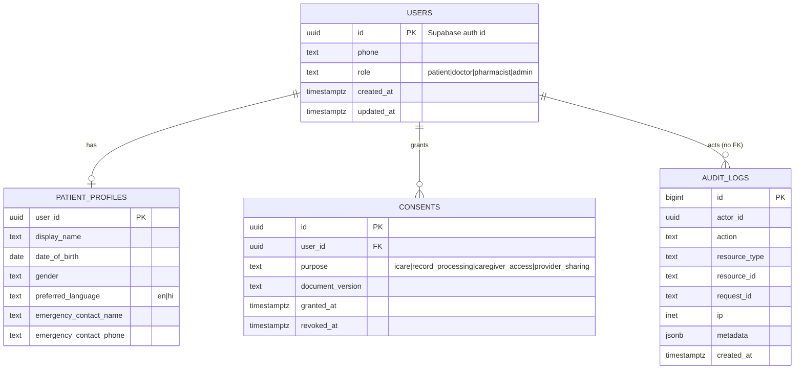

# Domain map

Only foundation tables exist. Dashed boxes are deferred modules.

## Deferred

- `app.documents`, `app.document_pages` — medical records and OCR
- `app.medicines`, `app.pharmacy_stock` — medicine catalogue and inventory
- `app.hospitals`, `app.doctors`, `app.ambulances` — provider directories
- `app.knowledge_documents`, `app.knowledge_chunks` — consented RAG corpus
- `app.notification_deliveries` — delivery audit

Each arrives with its module's migration, consent rules and clinical review. See
`docs/requirements/scope.md`.
