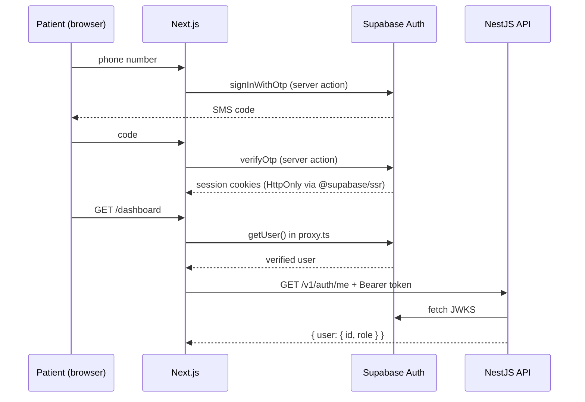
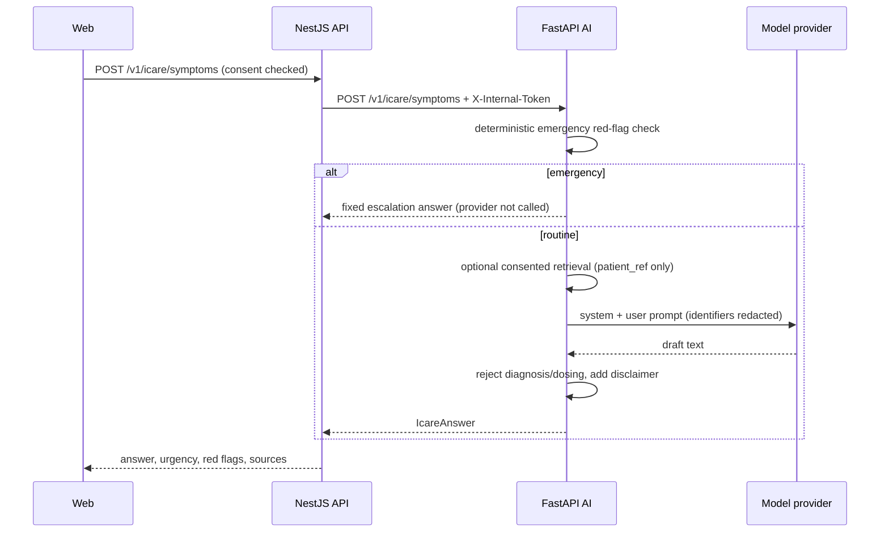

# Data flow

## 1. Phone OTP sign-in

- The browser never receives a service role key.
- `proxy.ts` uses `getUser()`, not `getSession()`, so the token is validated server-side.
- If Supabase env is missing, protected routes redirect to `/login`; there is no
  insecure fallback identity.

## 2. iCare symptom guidance (target flow, not wired)

The AI service exists and enforces this order in `app/orchestration/pipeline.py`. The
API gateway route and the web call are not built. Until they are, the UI states that
iCare is not connected.

## 3. Report explanation

Same pipeline with `report_text`. Identifiers are redacted before the provider sees the
text. If no records are supplied, the prompt says so; the model must not imply it has
the patient's history. Output is rejected if it contains diagnosis or dosing language,
and replaced with a safe fallback.

## 4. Medical record upload (planned)

1. Web requests an upload target from the API.
2. File goes to Supabase Storage under a per-user prefix, not through the API.
3. API enqueues `document-processing`.
4. Document worker calls an OCR adapter, stores extracted text and page references,
   and marks the document `failed` if extraction fails.
5. Patient sees processing state; nothing is guessed.

No upload, storage bucket policy or worker producer is implemented in this build.

## 5. Provider discovery (planned)

Search requests go to the API, which queries a provider adapter. Responses carry
`source` and `observed_at`. Stale data is labelled stale. If no contract exists, the
API returns an explicit "not configured" state, never sample entries.

## 6. Audit

`AuditLogInterceptor` records authenticated mutating requests and logs them through
`pino` with actor id, action, resource, request id and IP. Persisting to
`app.audit_logs` is the next step; the table already exists.

## Data minimisation

- Supabase owns credentials and sessions.
- `app.users` stores only id, phone and role.
- AI requests carry `patient_ref`, never phone numbers or government ids.
- Audit metadata must never contain clinical content.
