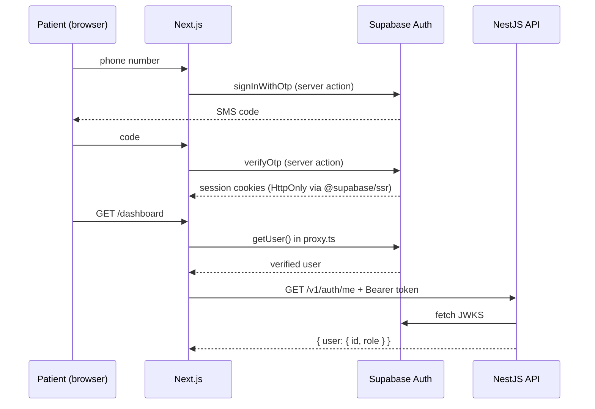
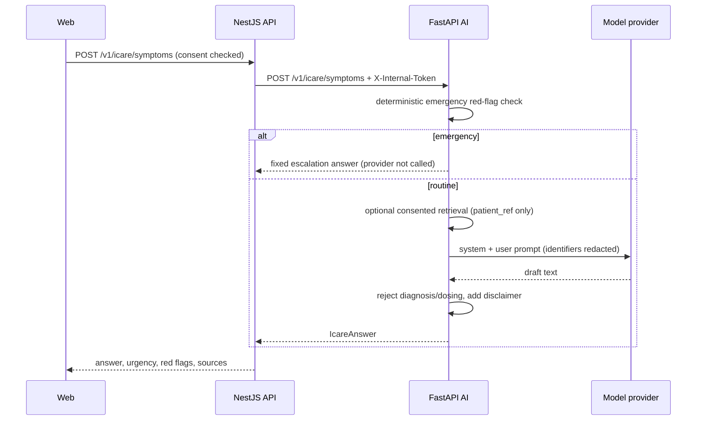
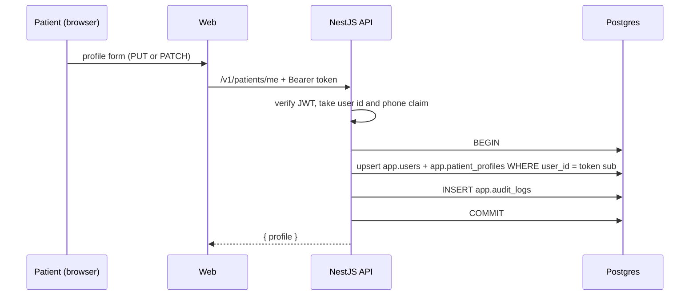
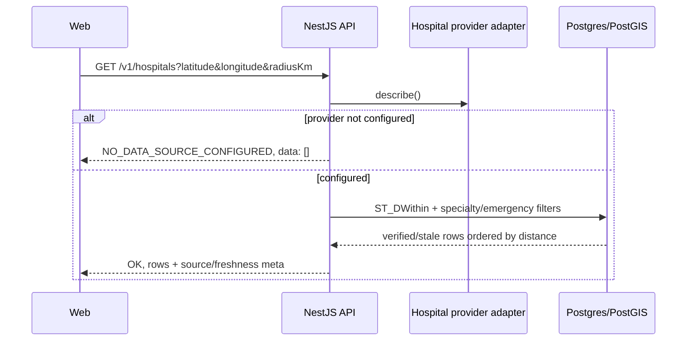

# Data flow

## 1. Phone OTP sign-in

- The browser never receives a service role key.
- `proxy.ts` uses `getUser()`, not `getSession()`, so the token is validated server-side.
- If Supabase env is missing, protected routes redirect to `/login`; there is no
  insecure fallback identity.

## 2. iCare symptom guidance (target flow, not wired)

The AI service exists and enforces this order in `app/orchestration/pipeline.py`. The
API gateway route and the web call are not built. Until they are, the UI states that
iCare is not connected.

## 3. Report explanation

Same pipeline with `report_text`. Identifiers are redacted before the provider sees the
text. If no records are supplied, the prompt says so; the model must not imply it has
the patient's history. Output is rejected if it contains diagnosis or dosing language,
and replaced with a safe fallback.

## 4. Medical record upload (planned)

1. Web requests an upload target from the API.
2. File goes to Supabase Storage under a per-user prefix, not through the API.
3. API enqueues `document-processing`.
4. Document worker calls an OCR adapter, stores extracted text and page references,
   and marks the document `failed` if extraction fails.
5. Patient sees processing state; nothing is guessed.

No upload, storage bucket policy or worker producer is implemented in this build.

## 5. Patient profile

- The request body never supplies `userId` or `phone`; both come from the verified
  token. Unknown fields are rejected.
- `PUT` replaces the profile and creates it when absent. `PATCH` updates selected
  fields and returns `404 profile_not_found` when no row exists.
- A failed audit insert rolls the profile change back (fail-closed). Reads still
  succeed if their audit insert fails (fail-open) and log `audit_persist_failed`.

## 6. Hospital discovery

- Only `verified` and `stale` rows are searchable; `unverified` rows stay hidden.
- Every row carries `source`, `lastSyncedAt`, `isStale` and
  `bedAvailability: "unknown"`. `hasEmergency: null` means the source did not verify
  emergency capability.
- With no licensed provider, the API does not query the database and does not invent
  records. This is the default state.

## 7. Audit

- `PatientsService` writes rich profile events. `AuditLogInterceptor` writes generic
  request success/failure events and skips success for `@ServiceAudited()` routes to
  avoid duplicates. `ApiExceptionFilter` writes guard-level 401/403 events once.
- `app.audit_logs` is append-only: triggers reject UPDATE, DELETE and TRUNCATE. RLS is
  default-deny for non-owner roles.
- Metadata is scrubbed of passwords, OTPs, tokens, secrets, cookies, phone, email,
  address and clinical content before insertion.
- There is no audit read API, retention policy or export yet.

## Data minimisation

- Supabase owns credentials and sessions.
- `app.users` stores only id, phone and role.
- `app.patient_profiles` stores the profile fields shown in the UI; no address,
  government id or clinical history.
- AI requests carry `patient_ref`, never phone numbers or government ids.
- Audit metadata must never contain clinical content.
