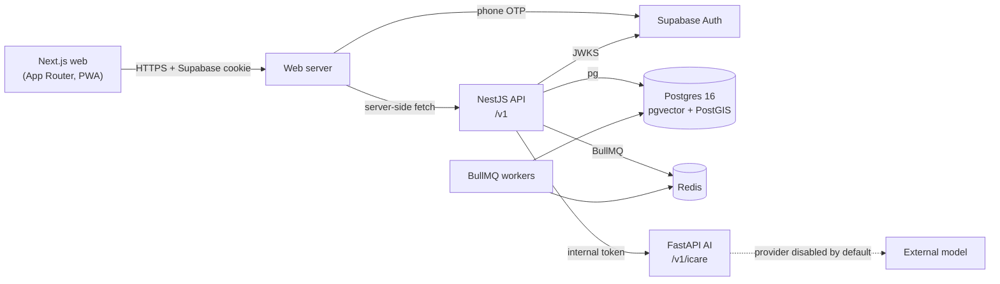

# System overview

Medicare is a healthcare navigation product for India: nearby hospitals, doctors,
emergency resources, medical records and the iCare AI assistant. This repository is the
foundation, not a finished product.

## Runtime components



| Component                  | Path             | Status                                                                                           |
| -------------------------- | ---------------- | ------------------------------------------------------------------------------------------------ |
| Web (Next.js 16, React 19) | `apps/web`       | Public pages, OTP login UI, patient shell, PWA. Provider screens show honest empty states.       |
| API (NestJS 12)            | `apps/api`       | Health, readiness, identity, patient profile read/write, hospital search with no-source state.   |
| AI (FastAPI)               | `apps/ai`        | Safety guard, intent routing, report/symptom endpoints, provider abstraction. Provider disabled. |
| Workers                    | `workers/*`      | Boot and consume queues; jobs fail honestly because no integration exists.                       |
| Shared TS packages         | `packages/*`     | Types, contracts, Zod validators, env config, typed client.                                      |
| Database                   | `database`       | Extensions, foundation schema, append-only audit trail, PostGIS hospital directory. No seeds.    |
| Infrastructure             | `infrastructure` | Local Compose, Postgres image, scripts, deployment and monitoring notes.                         |

## What a request does today

1. The web app checks Supabase Auth in `src/proxy.ts` (Next 16's replacement for
   `middleware.ts`) and fails closed when Supabase is unconfigured.
2. The API verifies a Supabase access token against the project's JWKS on every
   non-public route, then applies role checks and rate limits.
3. Errors return one JSON envelope with a request id (see `docs/api`).
4. API logs are structured (`pino`). Security events are also written to the
   append-only `app.audit_logs` table; there is no read API yet.
5. Patient profile reads/writes are scoped by the JWT subject. Hospital search reads
   verified PostGIS rows, or returns `NO_DATA_SOURCE_CONFIGURED` when the provider is
   disabled (the default).

The web app does not call the AI service yet. The iCare page says so instead of
pretending. The AI service is reachable only with `X-Internal-Token` and is designed to
sit behind the API, not the browser.

## Deliberate limits

- No hospital, doctor, pharmacy, ambulance or stock data is bundled or invented.
- No provider integration is enabled; every one defaults to `disabled`. The hospital
  finder therefore returns an explicit no-source state with no records.
- Bed and ICU availability are never numeric; the API returns `unknown`.
- No clinical module (records, appointments, prescriptions) is implemented.
- Audit rows are append-only but not exposed through a read API or retention job.
- No compliance certification is claimed. Privacy and clinical-safety constraints are
  documented, not certified.
- No queue producer exists yet, so workers will normally see no jobs.

## Local start

```bash
cp .env.example .env
pnpm install
pnpm db:up && pnpm db:migrate
pnpm dev                 # web + API (Turborepo)
pnpm dev:ai              # AI service, separate terminal (uv)
```

See the root `README.md` for the full command list and known gaps.
